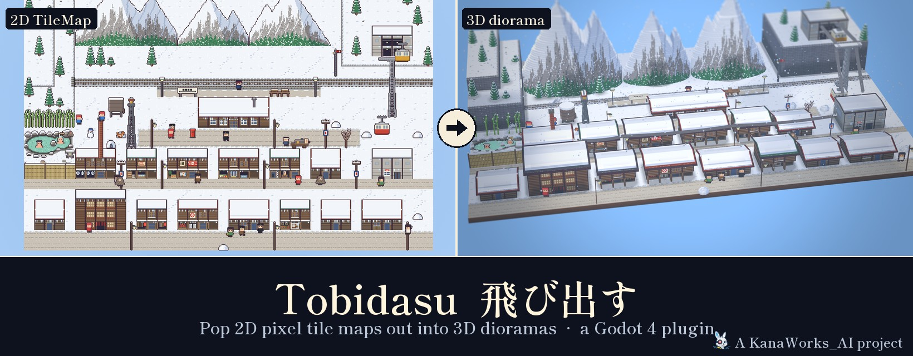
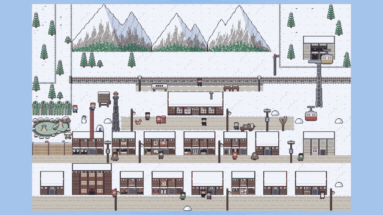
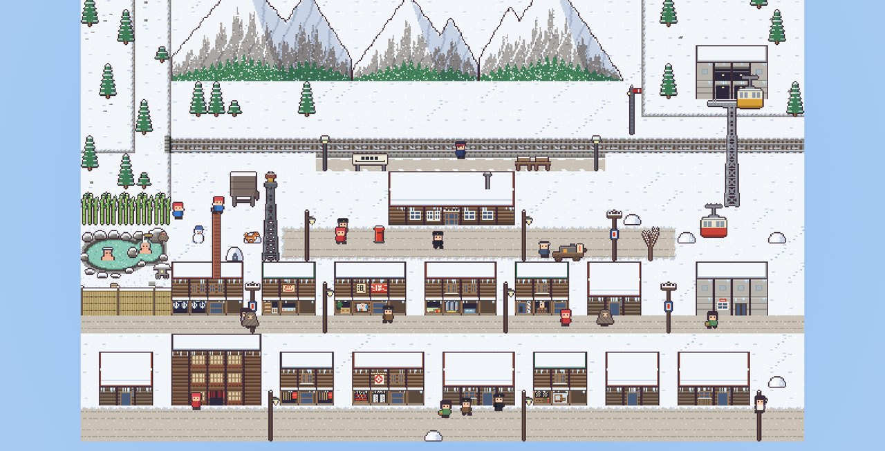
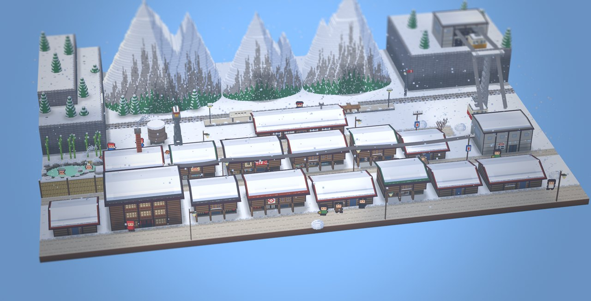
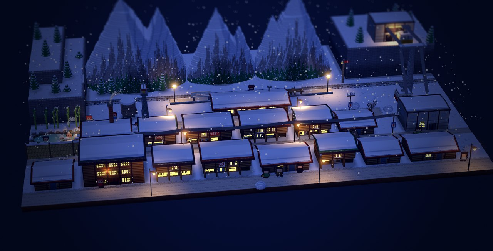
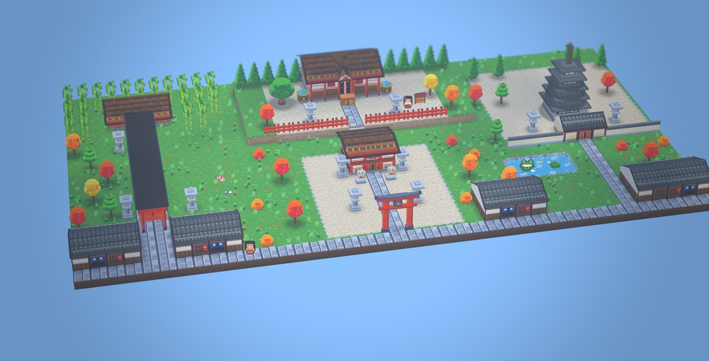
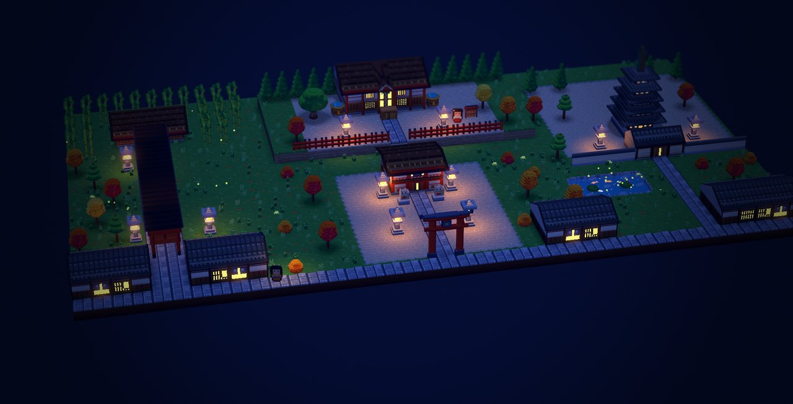
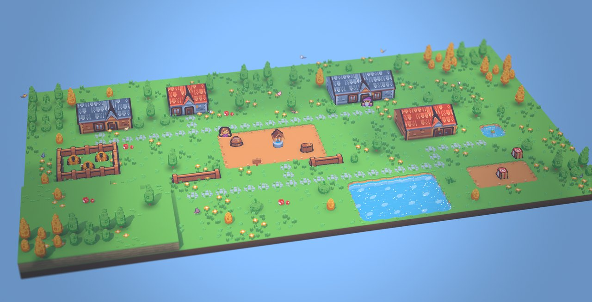
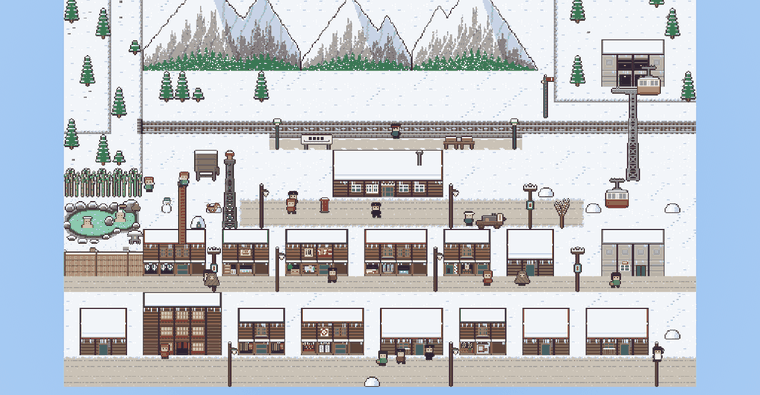

<div align="center">



<p>
  <a href="LICENSE"></a>
  
  
  
  <a href="https://github.com/kanaworksai-hue/tobidasu/stargazers"></a>
</p>

<p><a href="https://github.com/kanaworksai-hue"></a>&nbsp;<a href="https://github.com/kanaworksai-hue"><b>A KanaWorks_AI project</b></a></p>

[日本語](README.ja.md) | [English](README.md) | [简体中文](README.zh-CN.md) | **한국어**

[쇼케이스](#-쇼케이스) · [빠른 시작](#-빠른-시작) · [작동 원리](#-작동-원리) · [규칙](#-규칙) · [제한 사항](#-제한-사항) · [⭐ Star](#-마음에-들면-star를)

</div>

**Tobidasu**(飛び出す, '튀어나오다')는 이미 가지고 있는 2D 픽셀 아트 `TileMapLayer`를 3D 디오라마로 바꿔 주는 Godot 플러그인입니다. 2D와 3D 사이는 애니메이션으로 오갑니다.

- 집은 정면 벽이 일어서고 지붕이 올라갑니다.
- 나무는 땅에서 솟아오릅니다.
- 연못에는 물이 차오릅니다.
- 캐릭터는 세워진 카드가 됩니다.

손으로 모델링하지도, AI로 생성하지도 않습니다. 형태는 타일의 픽셀에서 바로 만들어집니다.

**Build 3D**를 누르고 `pop`을 0에서 1로 애니메이션하면 끝입니다.

<p align="center">
  <a href="https://github.com/kanaworksai-hue/tobidasu/releases/download/v0.1.0/tobidasu-showa-snow-town.mp4"></a>
  <br><sub>▶ <a href="https://github.com/kanaworksai-hue/tobidasu/releases/download/v0.1.0/tobidasu-showa-snow-town.mp4"><b>전체 영상 보기</b></a>: Tobidasu로 만든 쇼와 시대 눈의 마을 (2분 24초, 소리 있음)</sub>
</p>

## 🎉 Tobidasu를 오픈 소스로 공개했습니다


MIT 라이선스로 누구나 무료로 쓸 수 있습니다. 가지고 있는 타일맵으로 꼭 한번 시험해 보세요.

- **마음에 드셨다면:** **⭐ Star**를 눌러 주세요. Star 하나하나가 쓰는 사람이 있다는 신호가 되고, 계속 개발할 수 있는 힘이 됩니다.
- **질문, 버그, 아이디어:** [Issue](https://github.com/kanaworksai-hue/tobidasu/issues)를 남기거나, X의 [@KanaWorks_AI](https://x.com/KanaWorks_AI)로 편하게 메시지를 보내 주세요. 보내 주신 제안을 바탕으로 계속 개발하겠습니다.

## ✨ 특징

- **2D 화면이 한 픽셀도 바뀌지 않습니다.** 2D 맵과 3D 모델은 같은 메시입니다. `pop = 0`일 때 원래 `TileMapLayer`와 픽셀 단위로 똑같이 그려지므로, 전환에 튀는 부분이 없고 게임 도중에도 쓸 수 있습니다.
- **두 가지 스타일:** 블록 돌출, 또는 픽셀 단위 복셀.
- **그림을 보고 형태를 정합니다:**
  - **지면:** 길과 연못은 그려진 모양대로만 꺼지고, 고지대에는 바위 절벽이 생깁니다.
  - **물:** 물 바닥과 움직이는 수면.
  - **건물:** 정면 벽이 경첩처럼 일어서고 지붕과 박공이 따라옵니다. 깊은 처마와 1층이 안으로 들어간 아케이드도 지원합니다. 그림 속 창문을 찾아내 밤에는 불이 켜집니다.
  - **서 있는 것들:** 나무는 그려진 그림대로 일어서서, 뾰족한 나무는 원뿔, 둥근 나무는 구가 됩니다. 도리이, 탑, 석등도 같은 방식입니다.
  - **꽃과 풀:** 땅에 그려진 꽃은 줄기째 떠오르고, 풀은 한 가닥씩 자라 바람에 흔들립니다.
- **스프라이트는 카드로.** `Sprite2D` / `AnimatedSprite2D`가 카메라를 향해 서고, 애니메이션 프레임도 그대로 씁니다.
- **움직이는 부품.** 기차, 케이블카, 포장마차는 전용 작은 타일 레이어로 만들어 맵과 함께 튀어나와 달립니다. 터널에도 들어갑니다.
- **3D에서만 보이는 연출 (2D에서는 사라집니다):**
  - **빛과 날씨:** 바람, 접지 그림자(AO), 구름 그림자, 건물별 밤 조명, 눈, 연기.
  - **생물:** 나비, 반딧불이, 벌.
  - **전선:** 케이블과 전선.
- **픽셀 깜빡임 방지.** 카메라가 움직여도 픽셀 아트가 지글거리지 않는 필터가 들어 있습니다.
- **에디터 연동.** Godot 기본 TileSet 에디터에서 타일마다 '어떻게 솟아오를지·높이'를 칠할 수 있습니다(실행 취소 가능). 코드는 필요 없습니다.
- **웹에서도 동작.** 연출은 Forward+와 Compatibility 렌더러에서 똑같이 보이도록 만들었습니다.

## 🎬 쇼케이스

Tobidasu로 만든 데모 장면 세 개입니다. 모두 평평한 2D 타일맵에서 시작했습니다. 장면 자체는 이 저장소에 포함되어 있지 않습니다.

| | |
|:-:|:-:|
| <br><sub>쇼와 시대 눈의 마을: 2D 타일맵</sub> | <br><sub>…그것이 3D로 튀어나옵니다</sub> |
| <br><sub>밤: 창문 불빛, 가로등, 눈</sub> | <br><sub>교토: 센본 도리이, 오층탑, 신사</sub> |
| <br><sub>교토의 밤: 석등에 불이 켜집니다</sub> | <br><sub><a href="https://kenney.nl/assets/tiny-town">Kenney Tiny Town</a> 맵</sub> |

▶ [쇼와 시대 눈의 마을 전체 영상](https://github.com/kanaworksai-hue/tobidasu/releases/download/v0.1.0/tobidasu-showa-snow-town.mp4). 다른 영상도 X에서 공개하고 있습니다: [@KanaWorks_AI](https://x.com/KanaWorks_AI)

## 🚀 빠른 시작

1. `addons/tobidasu`를 프로젝트의 `addons/` 폴더에 복사하고, *프로젝트 설정 → 플러그인*에서 **Tobidasu**를 켭니다. Godot 4.7 이상이 필요합니다.
2. 3D 장면에 **`Tobidasu3D`** 노드를 추가하고, **`layers`**에 `TileMapLayer`를 넣습니다(지면 레이어를 맨 앞에). 카드로 세우고 싶은 캐릭터가 있으면 **`sprites`**에 넣습니다.
3. 인스펙터에서 **Build 3D**를 누르거나 `build_on_ready`를 켜 둔 채로 둡니다. 그다음 `pop`을 움직이면 됩니다.

```gdscript
@onready var diorama: Tobidasu3D = $Tobidasu3D

func pop_out() -> void:
	var t := create_tween().set_trans(Tween.TRANS_SINE)
	t.tween_property(diorama, "pop", 1.0, 1.2).from(0.0)
```

규칙 세트가 없으면 레이어 0은 평평하게 남고, 그 위의 레이어는 블록으로 솟아오릅니다. 집, 나무, 물 등은 **`TobidasuRuleSet`**으로 지정하거나([규칙](#-규칙) 참고), TileSet 에디터의 **Tobidasu** 패널에서 타일에 표시를 해 주세요.

끊김 없이 전환하려면, `pop`이 0인 동안에는 바로 위에서 내려다보는 직교 카메라를 쓰고, 같은 구도의 원근 카메라로 바꾼 다음 `pop`에 맞춰 기울이세요.

자주 쓰는 멤버:

| | |
|---|---|
| `pop`, `shade`, `stable_pixels` | 2D ⇄ 3D 진행도, 조명 양, 픽셀 필터 |
| `wind_strength`, `ambient_occlusion`, `cloud_shadows`, `night_lights`, `edge_highlight` | 3D 전용 연출 |
| `ground_height_at_map()`, `map_to_local()`, `tiles_to_local()` | 게임 오브젝트를 3D 지면 위에 놓기 |
| `get_buildings()`, `get_trees()`, `set_lights(cells, amount)` | 현관 조명, 건물별 조명 켜고 끄기 |
| `follow`, `visible_rect`, `elevation` | 움직이는 부품(메인 맵을 따라 달리는 탈것) |
| `TobidasuCritters`, `TobidasuWires` | 나비·반딧불이·눈·연기, 케이블과 전선 |

## 🧩 작동 원리

모든 정점은 '평평한 맵 위의 위치'와 '3D에서의 위치' 두 가지를 가지고 있고, 셰이더가 `pop`에 맞춰 그 사이를 움직입니다. 맵 위에 물결처럼 시간차가 생깁니다. 보이는 면의 2D 위치는 그 픽셀이 타일에 그려진 자리 그대로이므로, `pop = 0`의 메시는 타일맵을 픽셀 단위로 옮겨 놓은 것이 됩니다.

<p align="center">
  
</p>

높이는 픽셀에서 정해집니다.
- 지면은 픽셀 단위의 높이 맵입니다.
- 건물은 '위쪽 몇 줄이 지붕, 아래쪽 몇 줄이 벽'으로 읽습니다.
- 나무처럼 서 있는 것은 흔히 쓰는 비스듬한 내려다보기(3/4 뷰) 그림을 한 줄씩 일으켜 세웁니다. 지면 선에서 몇 줄 위인지가 높이, 그 줄의 폭이 깊이가 됩니다.

## 📐 규칙

`TobidasuRuleSet`은 `TobidasuRule`의 순서 있는 목록으로, 아틀라스 좌표로 맞춰 보고 처음 맞는 규칙을 씁니다(TileSet 표시가 우선). 모드:

| 모드 | 용도 |
|---|---|
| `FLAT` | 풀밭, 길, 눈(길과 연못은 색으로 꺼지게 할 수 있음) |
| `BLOCK` / `DOME` | 벽, 생울타리, 둔덕(일정한 높이 / 가운데로 갈수록 높게) |
| `LUMA` | 밝기로 높이 결정 |
| `ROOF` / `WALL` | 건물: 지붕 줄과 벽 줄, 박공, 처마, 아케이드, 빛나는 창문 |
| `WATER` | 연못, 온천 |
| `TREE` | 3/4 뷰로 그려진 서 있는 것 전부: 나무, 도리이, 탑, 석등, 산, 탈것 |
| `PROP` | 템플릿 소품(우물, 터널 입구) |

잘 솟아오르는 그림을 그리는 요령:
- 형태와 형태 사이는 1픽셀 어두운 외곽선으로 나누세요.
- 형태 안쪽 색은 외곽선보다 밝게 하세요.
- 창문은 창틀로 둘러싸서 유리가 타일 가장자리에 닿지 않게 하세요.
- 건물과 건물 사이는 한 칸 비워 두세요.

## ⚠️ 제한 사항

- **건물:** 직사각형이며 '지붕 줄 + 벽 줄'로 읽습니다. L자형, 우진각 지붕, 비대칭 지붕은 아직 지원하지 않습니다.
- **서 있는 것의 단면:** 원형 또는 사각형입니다.
- **캐릭터:** 카드이며 복셀 인형이 아닙니다. 장면과의 충돌 판정도 없습니다.
- **생성 시간:** 빌더가 GDScript라서 큰 맵은 생성에 조금 시간이 걸립니다.
- **아틀라스:** 16px 타일에 2의 거듭제곱으로 정렬된 아틀라스가 가장 안정적입니다.

## 🗺️ 로드맵

- [ ] 가져온 타일셋의 규칙 제안과 검사 도구, 3D 디버그 오버레이
- [ ] 인기 타일 에셋용 기성 규칙
- [ ] 더 빠른 생성: 분할 생성, 백그라운드 스레드, 바뀐 부분만 다시 생성
- [ ] 더 많은 건물 형태: 우진각 지붕, 비대칭 지붕, L자형, 계단식 후퇴, 휘어 올라간 처마
- [ ] 데이터로 쓰는 소품 템플릿
- [ ] 선택형 복셀 캐릭터와 간단한 충돌 판정
- [ ] 누운 원기둥(보일러, 배관)

Issue와 Pull Request를 환영합니다.

## ⭐ 마음에 들면 Star를

Tobidasu로 타일맵이 튀어나왔다면, [저장소 페이지](https://github.com/kanaworksai-hue/tobidasu) 위쪽의 **⭐ Star**를 눌러 주세요. 무료이고, 다른 Godot 개발자들이 찾기 쉬워지며, 계속 개발하는 큰 힘이 됩니다.

그 밖에도 [Issue](https://github.com/kanaworksai-hue/tobidasu/issues)를 남기거나, 만든 것을 X에서 [@KanaWorks_AI](https://x.com/KanaWorks_AI)를 태그해 보여 주시면 큰 도움이 됩니다.

## 📄 라이선스와 크레딧

- **이 프로젝트:** [MIT](LICENSE).
- **브랜드:** KanaWorks_AI 이름, 로고, 캐릭터 Kana의 권리는 東京AI映像合同会社(Tokyo AI Visuals LLC)에 있으며 MIT 라이선스 대상이 **아닙니다**. [docs/brand](docs/brand/README.md)를 참고하세요.
- **쇼케이스 이미지:** 마을 장면은 [Kenney](https://kenney.nl)의 Tiny Town / Tiny Battle / Tiny Dungeon(CC0)을 사용했습니다. 교토와 쇼와 장면은 오리지널 그림입니다. 데모 장면은 이 저장소에 포함되어 있지 않습니다.
- **사용 기술:** [Godot Engine](https://godotengine.org).

이 프로젝트는 개인의 독립 프로젝트이며 Godot Foundation과는 관계가 없습니다.

<br>

<div align="center">

<a href="https://x.com/KanaWorks_AI"></a>

<p><b>Made with ♥ by <a href="https://x.com/KanaWorks_AI">KanaWorks_AI</a></b></p>

<p><sub>Tobidasu가 도움이 되었다면 ⭐ 부탁드립니다. 다른 프로젝트: <a href="https://github.com/kanaworksai-hue">github.com/kanaworksai-hue</a></sub></p>

</div>
